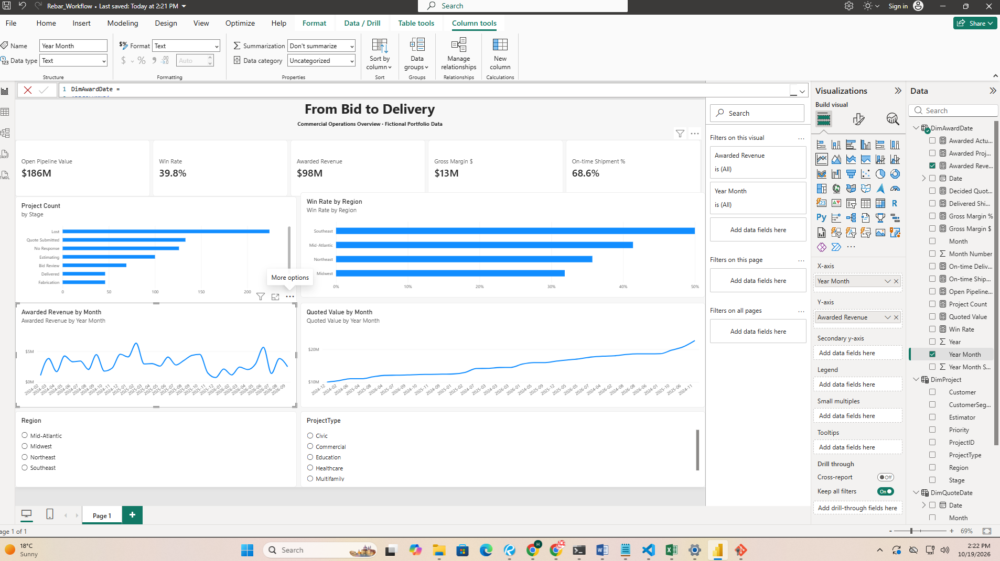
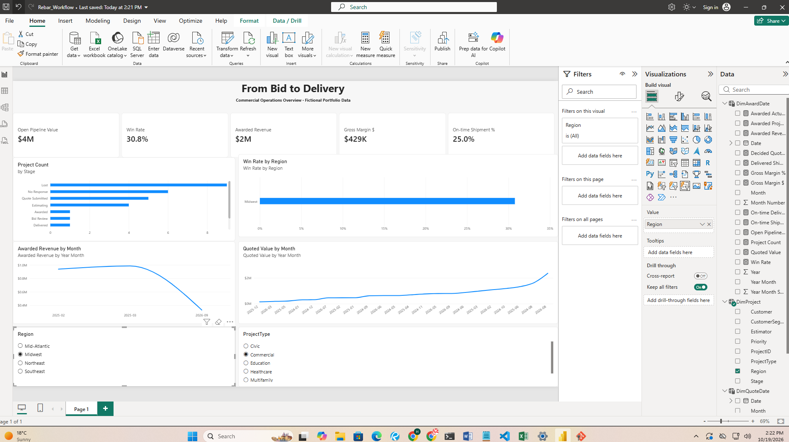
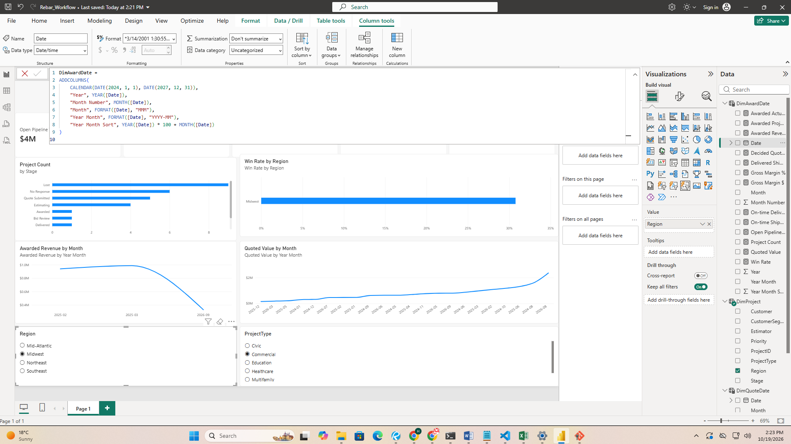

# From Bid to Delivery | Power BI Portfolio Project

An end-to-end analytics case study for a fictional rebar fabrication and supply contractor. The project follows commercial opportunities from estimate through award and shipment, with a focus on bid conversion, open pipeline, margin, and delivery reliability. `PORTFOLIO_PREVIEW.html` is a local visual prototype generated from the CSVs; recreate its visuals and extend the analysis in Power BI Desktop.

The finished Power BI report is included as `Rebar_Workflow.pbix`. Open it with Power BI Desktop to explore the report and model. The CSVs, DAX measures, Power Query starter, and documentation are included so the analysis is transparent and reproducible.

## Report screenshots

### Executive overview

### Filtered dashboard view

This view demonstrates cross-filtering with Region set to Midwest and ProjectType set to Commercial.

### Model-building view

The report's date dimension was created as a DAX calculated table.

## Data and confidentiality

Every record, company, person, project ID, amount, and date in `data/` is generated for this portfolio project. No employer files, names, screenshots, or business records were used. The data generator is deterministic: running `python generate_data.py` recreates the same dataset.

## Project questions

- How much quoted value is still in the open pipeline, and where is it concentrated?
- Which regions, customer segments, project types, and estimators convert opportunities into awards?
- How does realized gross margin compare across awarded projects?
- What share of delivered shipments arrived on or before their planned date?
- How does quoted tonnage move through award, fabrication, and delivery?

## Business recommendations

In this fictional snapshot, 68.6% of completed shipment lines are on time. A manager should investigate where late deliveries cluster before choosing a corrective action: compare on-time performance and late tons by region, project type, planned ship month, and project, then review planned-versus-actual dates. Follow up on the largest or repeated delays by checking production capacity, material readiness, schedule buffers, carrier availability, and job-site constraints. These are investigation paths, not proven causes; the data is synthetic and does not establish causation.

## Included files

- `data/Projects.csv`: one row per opportunity / project.
- `data/Shipments.csv`: one row per scheduled or completed shipment; projects may have multiple partial shipments.
- `power_query/LoadData.m`: starter Power Query M for importing and typing both files.
- `dax/Measures.dax`: business measures with definitions and formatting guidance.
- `DATA_DICTIONARY.md`: field definitions, assumptions, and known limitations.
- `MODEL_AND_REPORT_GUIDE.md`: relationship design, report pages, and build sequence.
- `SAMPLE_FINDINGS.md`: calculated example findings from the generated snapshot.
- `PORTFOLIO_PREVIEW.html`: responsive visual prototype for the executive overview page.
- `Rebar_Workflow.pbix`: interactive Power BI report file.
- `generate_data.py`: reproducible synthetic-data generator.
- `build_preview.py`: regenerates the HTML report prototype and sample findings.

## Build in Power BI Desktop

The included `Rebar_Workflow.pbix` currently contains the executive overview page. Open it in Power BI Desktop to explore the report. The remaining steps are optional if you want to rebuild or extend the model from the included source files.
2. To rebuild from source, use **Get data → Blank query → Advanced Editor** and follow `power_query/LoadData.m`, setting the data folder to this package's `data` folder.
3. In Model view, create the relationships described in `MODEL_AND_REPORT_GUIDE.md`. Keep the project and shipment fact tables separate so project quote value is never multiplied by the number of shipment rows.
4. Add the measures from `dax/Measures.dax` and use the guide to extend the report. Validate any new findings against the source data.

## Portfolio description

> Built a Power BI commercial operations dashboard for a fictional construction materials supplier. Generated and modeled a two-fact dataset, shaped CSV sources with Power Query, created DAX measures for pipeline, conversion, margin, and on-time delivery, and designed an executive report that follows projects from bid through shipment.

Describe this as a self-directed portfolio project. Do not present it as professional work completed for a real company.
